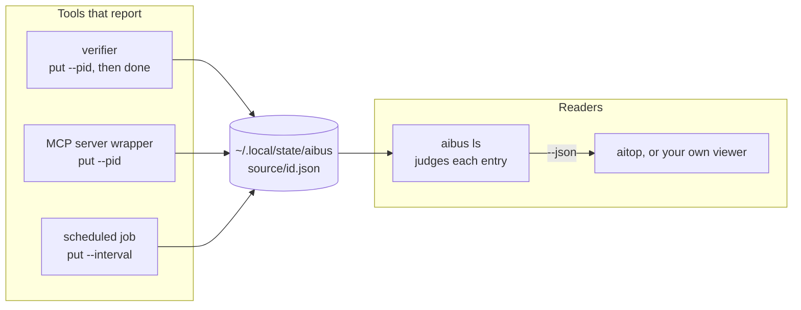
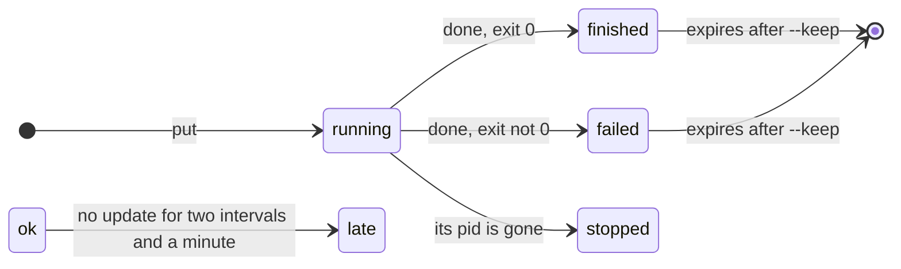

<div align="center">


# aibus

**A status board on disk for the tools that run next to your AI agents**

Verifiers, scheduled checks and MCP servers each write one small file about what they are doing.<br>
Viewers read one folder, and aibus tells them which entries are still alive.

[](#install)
[](aibus)
[](LICENSE)

</div>

```sh
aibus put  xverify run-42 --title "verify dotfiles" --ai codex --pid $$
aibus put  xverify run-42 --progress 3/4 --now "codex exec in python:3.14-slim"
aibus done xverify run-42 --exit-code 0 --link report=/tmp/run-42/report.md
aibus ls
```

```
SOURCE       ID                           STATUS       UPDATED  NOW / TITLE
mac          slow-log                     warn              2m  swap 4970/6144M pressure=warn load=5.23
mcp          claude-wiki-mcp-1            running           1h  wiki-mdgraph for claude
xverify      run-42                       finished(0)       4s  codex exec in python:3.14-slim
```

## Why it exists

Claude Code and Codex keep transcripts, so a viewer such as [aitop](https://github.com/dor1a/aitop) can read their sessions directly. The tools around them leave no such record in one place. A verification container, a launchd job that runs every five minutes and an MCP server each log somewhere different, and a viewer would have to learn every one of them.

aibus turns that around. Each tool reports itself with one command, and every viewer reads the same folder. There is no daemon to keep running. Whether an entry is still alive is decided when it is read:

- a tool that registered its process and then died shows as `stopped`
- a scheduled job that misses two runs shows as `late`
- finished work drops out of the default list after a day

## Install

macOS, with Homebrew:

```sh
brew install dor1a/tap/aibus
```

Linux and WSL, from a clone:

```sh
git clone https://github.com/dor1a/aibus.git
cd aibus
./install.sh
```

`install.sh` links `aibus` into `~/.local/bin` and says so when that folder is not on your `PATH`. If it is not, add it in your shell's rc file:

```sh
export PATH="$HOME/.local/bin:$PATH"
```

To update, run `brew upgrade aibus`, or `git pull` in the clone.

aibus needs Python 3.9 or later and uses only the standard library, so the macOS `/usr/bin/python3` is enough.

## Usage

| Command | What it does |
| -- | -- |
| `aibus put SOURCE ID [options]` | Create the entry or update the fields you pass. The rest stay as they were. A `--pid` other than the stored one starts the entry over, so a new process does not inherit the old run's start time, progress or exit code |
| `aibus done SOURCE ID [--exit-code N] [--keep SEC]` | Mark it `finished`, or `failed` for a non-zero exit code, and keep showing it for a day (or `--keep` seconds) |
| `aibus rm SOURCE ID [--pid PID]` | Delete the entry. With `--pid`, delete it only if that process wrote it |
| `aibus ls [--json] [--all] [--source S] [--reader NAME]` | List entries with their judged status. `--all` includes expired ones. `--reader` records who read, for `status` |
| `aibus status [--json]` | Show what is connected: the bus folder, every source that wrote and every reader that read |
| `aibus gc [--days N]` | Delete entries whose expiry passed more than N days ago, and `stopped` or `late` entries with no update for N days (default 7) |

`SOURCE` groups entries, for example `xverify`, `mcp` or `mac`. `SOURCE` and `ID` take letters, digits, `.`, `_` and `-`, start with a letter or digit, and are at most 128 characters.

Options for `put`. `done` also takes `--state`, `--progress`, `--now`, `--link` and `--exit-code`, so the last step count and output line can go in with the final status:

| Option | Field |
| -- | -- |
| `--title TEXT` | A name for the entry |
| `--ai NAME` | Who runs it: `claude`, `codex`, or anything else |
| `--state STATE` | `running` (the default), `ok`, `warn`, `failed` or `finished` |
| `--progress N/M` | Steps done out of the total |
| `--now TEXT` | The latest line of output or a short status. Folded to one line, 300 characters at most |
| `--link NAME=PATH` | A report, log or URL. Repeat for more |
| `--pid PID` | The process doing the work, 1 or more. Once it is gone the entry is `stopped` |
| `--interval SEC` | How often a scheduled job reports. Two intervals and a minute without an update make it `late` |
| `--exit-code N` | The exit code, shown next to the status |

### Reporting from a script

Status reporting should never break the tool that does it. Call aibus only when it is installed and ignore its exit code:

```sh
report() { command -v aibus >/dev/null 2>&1 && aibus "$@" >/dev/null 2>&1 || true; }

report put backup nightly --title "nightly backup" --ai cron --pid $$
rsync -a src/ dst/
report done backup nightly --exit-code $?
```

A job that runs on a timer reports with an interval instead of a process:

```sh
report put mac slow-log --interval 300 --state ok --now "swap 1.2G, pressure normal"
```

A server that can be killed before it cleans up, such as an MCP server under an AI client, can leave the cleanup to a watcher that outlives it. The watcher should pass the server's pid, so it does not delete the entry of a newer server that has taken the same ID by then:

```sh
report put mcp wiki-1 --title "wiki server" --pid $$
# later, from the watcher
report rm mcp wiki-1 --pid "$server_pid"
```

launchd jobs and agent hooks run with a short `PATH` that may not include Homebrew, so a script run from them should also look for aibus in `/opt/homebrew/bin`, `/usr/local/bin` and `~/.local/bin`.

### Reading it

`aibus ls --json` prints one object that viewers can rely on:

```json
{
  "aibus": "0.1.0",
  "schema": 1,
  "now": 1794289279.5,
  "warnings": [],
  "items": [
    {
      "schema": 1,
      "source": "xverify",
      "id": "run-42",
      "title": "verify dotfiles",
      "ai": "codex",
      "host": "my-mac",
      "pid": 41237,
      "state": "finished",
      "status": "finished",
      "exit_code": 0,
      "progress": [3, 4],
      "now": "codex exec in python:3.14-slim",
      "links": {"report": "/tmp/run-42/report.md"},
      "started": 1794289278.7,
      "updated": 1794289279.1,
      "expires": 1794375679.1,
      "expired": false
    }
  ]
}
```

Times are Unix seconds. Fields a tool never set are absent rather than `null`.

`state` is what the tool last wrote. `status` is what to show: it is `stopped` or `late` when the tool went away without saying so, and the same as `state` otherwise. Unreadable files are listed in `warnings` and skipped.

A viewer should pass `--reader NAME` (aitop passes `--reader aitop`). aibus then notes when that viewer last read, at most every ten seconds, so `aibus status` can show it.

## How it works



Writers never talk to readers. Each `put` or `done` rewrites one file under a lock, and `ls` reads the folder and decides what to show from the file and the clock:



`stopped` and `late` are never written to the file. They are what `ls` concludes when the tool stopped reporting, so a tool that crashes or a job that no longer runs shows up without anyone having to notice.

### Where the files live

| | |
| -- | -- |
| Folder | `~/.local/state/aibus/<source>/<id>.json`, or `$AIBUS_HOME` |
| Permissions | Folders 700, files 600 |
| Refused | A bus folder that is a symlink or belongs to someone else stops every command. A source folder like that is refused by `put`, `done` and `rm`, skipped with a warning by `ls`, and skipped without one by `gc`. Symlinked entries are skipped with a warning |
| Broken entries | An entry is malformed when a field has the wrong type or range, for example `NaN`, a progress past its total or a negative interval. `ls` skips it with a warning, and `put` and `done` leave it alone and fail, so `aibus rm` is the way to start it over |
| Writes | Each update holds a lock on its source folder and replaces the file atomically, so concurrent updates do not lose fields. `gc` decides again under the same lock, so it never deletes an entry that was just updated |

Entries carry whatever text your tools put in them, such as file paths and command output. Keep secrets out of `--now` and `--link`.

## Troubleshooting

When a viewer shows nothing, `aibus status` tells which side to look at:

```
bus      /Users/me/.local/state/aibus  ok
version  aibus 0.1.0, schema 1
writers
  mac            1 entry    last write   1s ago  warn 1
  mcp            2 entries  last write  42m ago  running 2
  xverify        1 entry    last write   3h ago  finished 1
readers
  aitop        last read   0s ago
```

| What `status` shows | Where the problem is |
| -- | -- |
| `refusing` on the `bus` line | The bus folder itself: a symlink, someone else's folder, or not a folder. Every command stops until it is fixed |
| A tool missing under `writers` | The tool is not reporting. Run its `aibus put` by hand: aibus may not be on the `PATH` the tool runs with (launchd and hooks have a short one), and a wrapper that ignores aibus errors hides that |
| Writers fine, the viewer missing under `readers` or its last read long ago | The viewer is not reading: it is not running, aibus is not on its `PATH`, or it does not pass `--reader` |
| Both fine, still nothing on screen | The viewer's own filter, such as aitop's `--ai`, or aitop keeping ended records and entries that last reported `ok` behind `l` |

`aibus status --json` prints the same as one object, and exits 1 when the bus folder is refused.

## Uninstall

```sh
brew uninstall aibus
```

For a clone, remove the link and then the clone:

```sh
rm ~/.local/bin/aibus
```

The entries stay in `~/.local/state/aibus` (or `$AIBUS_HOME`) until you delete that folder.

## Development

The tests use only the standard library:

```sh
python3 -m unittest discover -s tests
```

## License

[MIT](LICENSE)
